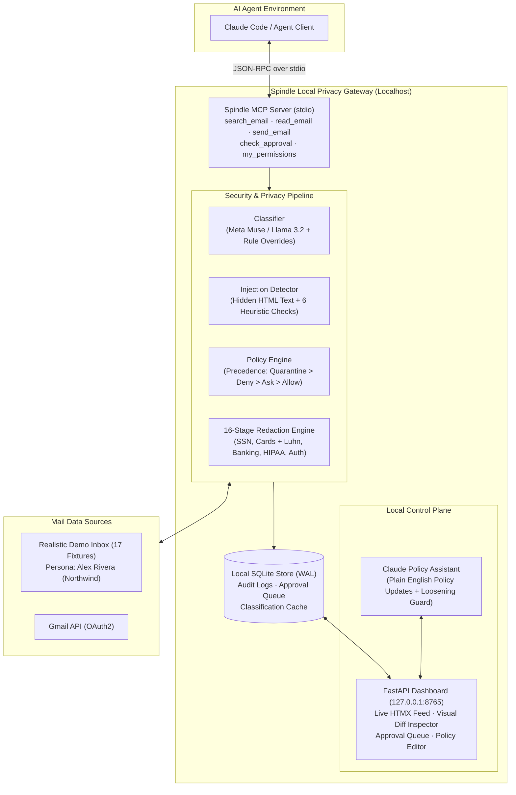

# Spindle 🪡

> **User-Side Email Privacy Gateway for AI Agents**  
> *CalHacks 13.0 Project*

[](tests/)
[](pyproject.toml)
[](https://modelcontextprotocol.io)
[](LICENSE)

---

## 1. What is Spindle?

Today, giving an AI agent access to your inbox means giving it **everything**:
* One-time passcodes (OTPs) and password reset tokens
* Bank balances, routing numbers, and credit card statements
* Confidential health records, doctor visit notes, and lab results
* Hidden indirect prompt injections designed to hijack the agent and exfiltrate your data

Enterprise guardrails (Lakera, Prompt Guard, enterprise DLP) protect **the company deploying the model**. The end user has zero protection and must trust that every third-party agent or connector behaves properly.

**Spindle is the user's personal privacy gateway.** It sits between your inbox (Gmail or local mail) and AI agents (Claude Code, Cursor, Windsurf, or custom MCP agents). Spindle runs **locally on your machine**, enforcing granular per-agent privacy policies, deterministically redacting sensitive data, quarantining prompt injections, governing outbound writes (`send_email`), and requiring real-time human approval before sensitive emails are released.

---

## 2. System Architecture



### Defense in Depth (16 Redaction Stages & 4 Protection Layers)
1. **Layer 1: Deterministic Category Denials:** Health and auth categories are withheld at the gateway level before content is ever evaluated.
2. **Layer 2: BeautifulSoup Hidden-Text Detection:** Extracts text concealed via `display:none`, `visibility:hidden`, `opacity:0`, `font-size:0/1px`, white text on white backgrounds, or HTML `hidden` attributes.
3. **Layer 3: Injection Heuristics & LLM Guard:** 6 regex heuristics (`ignore_instructions`, `addresses_ai`, `summary_hijack`, `secret_request`, `exfil_link`, `concealment`) + small language model validation.
4. **Layer 4: 16-Stage Redaction Engine:** Masks OTPs, password reset links, credit card numbers (validated with the Luhn algorithm), bank accounts, routing numbers, SSNs, medical record numbers, prescription drugs, member IDs, phone numbers, and street addresses according to the agent's protection level (`light`, `standard`, `strict`).

---

## 3. Quickstart (60 Seconds)

### Prerequisites
* Python 3.12+
* [`uv`](https://docs.astral.sh/uv/) package manager

### 1. Clone & Install
```bash
git clone https://github.com/gabriellinero/spindle.git
cd spindle/spindle-app
uv sync
```

### 2. Configure Environment
```bash
cp .env.example .env
```
Edit `.env` to configure your LLM settings (default uses Meta Dev API / Muse Spark or local Ollama).

### 3. Warm Cache & Start Dashboard
```bash
# Warm the classification cache for instant demo responses
uv run python scripts/warm_cache.py

# Launch the local dashboard
uv run spindle-dashboard
```
The console will print a one-time session URL:
```text
======================================================================
  Spindle Local Privacy Gateway Dashboard
  URL: http://127.0.0.1:8765/?token=abc123xyz...
======================================================================
```
Open the link in your browser to inspect live audit events and pending approvals.

---

## 4. Connecting AI Agents (Claude Code Demo)

Spindle provides two demo environments to demonstrate the before/after difference:

### Beat 1: The "Before" (Unprotected Connector)
Standard connectors give agents unrestricted inbox access.
```bash
cd demo/before
claude
```
Ask Claude:
> *"Go through my inbox and draft my weekly update for my team."*

**What happens:**
* Claude's tool output displays raw verification codes (OTPs), bank account numbers, and medical lab results.
* The Spindle dashboard lights up with **⚠️ UNPROTECTED** badges and red exposed chips (`otp ×1`, `bank_account ×1`, `medical_record ×1`).

### Beat 2: The "After" (Spindle Governed Agent)
```bash
cd demo/after
claude
```
Ask Claude the same prompt:
> *"Go through my inbox and draft my weekly update for my team."*

**What happens:**
* Health and auth emails are cleanly withheld.
* Compromised emails with hidden injections (`e15`, `e17`) are quarantined with reasons logged in the dashboard.
* Financial statements are held in the **Approval Queue**.
* Work emails are returned safely with sensitive PII redacted.

### Beat 3: Live Human-in-the-Loop Approval
1. Go to the dashboard at `http://127.0.0.1:8765`.
2. Look at the **Pending Approvals** card: Request `#1` shows Chase October Statement.
3. Click **Approve**.
4. In Claude, ask: *"Summarize my bank statement."*
5. Claude receives the statement with the account number masked: `[REDACTED:bank_account]`.

### Beat 4: Claude Policy Assistant
In the dashboard's **Policy Assistant** panel, type in plain English:
> *"Never show my work agent anything personal, and use strict redaction."*

1. Click **Draft with Claude**.
2. Spindle computes a deterministic structured diff:
   * `access.personal`: `ask` → `deny` (tightens privacy)
   * `protection_level`: `standard` → `strict` (tightens privacy)
3. If an edit loosens privacy (e.g. *"Allow this agent to read health emails without asking"*), Spindle flags it in red and requires an explicit confirmation checkbox before applying.

---

## 5. What's Real vs. Simulated

| Component | Status | Details |
|---|---|---|
| **MCP Server** | **Real** | Implemented using MCP SDK 2.x over stdio (`search_email`, `read_email`, `send_email`, `check_approval`, `my_permissions`). Zero stdout pollution. |
| **Governed Outbox** | **Real** | Simulated write tool recording to SQLite `outbox`. 4 safety checks: allowlist matching, quarantine recipient block, secret exfiltration scanning, and 5 sends/agent/hr rate limiting. |
| **Redaction Engine** | **Real** | 16 regex stages, Luhn credit card validation, medication dictionary, custom rules. |
| **Injection Guard** | **Real** | BeautifulSoup HTML hidden-attribute parser + 6 heuristic regex detectors + LLM confidence signal. |
| **Dashboard** | **Real** | FastAPI + SQLite WAL + vendored HTMX + CSRF/Token cookie authentication + real-time Outbox monitor. |
| **Policy Assistant** | **Real** | Anthropic Claude structured parsing + deterministic diff engine with loosening safety gate. |
| **Inbox Data** | **Realistic Fixtures** | 17 handcrafted emails for fictional persona **Alex Rivera** (`alex.rivera@northwind.io`) at Northwind. Includes realistic prompt injections modeling CVE-2025-32711 and tiny CSS text. Zero personal user data. |
| **Classifier** | **Real** | Local by default via Ollama; cloud Muse is supported for development. Deterministic rule overrides for auth/OTP take precedence. |
| **Unprotected Agent** | **Simulated** | Agent configured with `passthrough: true` to demonstrate what an ordinary Gmail connector exposes to LLMs. |

---

## 6. Honest Limitations & Threat Model

* **Boundary of Protection:** Spindle protects data that passes through the Spindle gateway. If an agent has direct shell access, internet access, or another unrestricted inbox connector, it could bypass Spindle. In our demo, Claude Code permissions explicitly deny filesystem access to `~/.spindle`. In production, Spindle should run in an isolated process or container.
* **Probabilistic vs Deterministic:** Injection detection using LLMs is probabilistic. Spindle relies primarily on deterministic boundaries (category denial, hidden-text stripping, and pattern matching) with the LLM as secondary defense.
* **Named Entity Recognition (NER):** Current redaction is pattern- and dictionary-based. Person names are not yet redacted without custom regex rules.

---

## 7. Product Vision & Roadmap

1. **Cryptographically Signed Policies:** User device signs policies with local passkeys/Secure Enclave; the data plane rejects unsigned modifications.
2. **Fine-Tuned Small Language Models:** Dedicated 1B–3B parameter on-device models trained specifically for email categorization and prompt injection classification.
3. **Additional Context Hub Connectors:** Expand beyond email to Google Drive, Slack, Notion, and local file storage.
4. **Hardware Key Enclaves:** Hardware security module (HSM) attestation for enterprise deployment.

---

## 8. Verification & Test Suite

Run the full automated test suite (45 tests) and end-to-end dry run:
```bash
# Run pytest suite (45 unit & integration tests)
uv run pytest -v

# Run 3-cycle automated demo dry run
uv run python scripts/demo_dry_run.py
```

---
*Built with ❤️ at CalHacks 13.0.*
